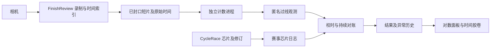

# 比赛中视频与芯片核对规划

> 历史方案（2026-10-15 标注）：独立“对数”入口、报告读取器及历史对账工具已移除。
> 本文保留当时的调查和规划，不代表当前功能；后续主线见
> [终点问题清单实施方案](CONTINUOUS_REVIEW_IMPLEMENTATION_PLAN.md)。

日期：2026-10-13。接续 Claude 在“现状调查与规划”阶段中断的工作。

目标：比赛进行时，视频过线观测与收到的芯片记录持续核对。正常通过自动归入无需逐条处理的列表；操作员优先看疑似漏读、疑似额外芯片和证据不足的片段。沿用当前放大、逐帧、标线、待补录操作，缩短赛后复核时间。

本文是实施规划。已完成本机数据与代码检查、现状复现和既有离线观测的重新计算；实时产品功能尚未实现。

实施进度：P0 已交付 v0.24.9，软件修复及本机验证见 [赛事隔离与旧录像恢复](P0_WORKSPACE_VALIDATION.md)。现场相机连接与长时间运行仍需实机验收。

## 已核实的现状

| 项目 | 本次检查结果 | 对使用的影响 |
| --- | --- | --- |
| 桌面程序 | `FinishReview-v0.24.8.exe`，2026-09-18 18:59 打包 | 不含 10 月加入的对数面板和异常历史；源码功能不能当成已经交付的软件功能 |
| 当前源码 | `main`，检查时为 `e00465c`，工作区无未提交改动 | Claude 提到的另一窗口改动已经提交，不再需要等待它提交 |
| 软件配置 | 工作目录为用户桌面的 `race` | 必须兼容这份旧赛事目录，保留已有人工确认与原帧 |
| 通过记录 | 最新有效记录：定边 302、可克达拉 774、特奥活动 8，共 1,084 | 列表混入其他赛事，导致大量无关“待人工确认” |
| 混入时间 | 特奥活动记录于 10 月 12 日 17:24 收到；可克达拉记录于 17:44–17:45 收到 | 不是把一名选手的修订重复计算；确有另外两个 `race_id` 的消息进入同一目录 |
| 旧目录元信息 | 根目录无 `cyclerace_race_metadata.json`，收件箱无赛事元信息快照 | 当前代码在元信息缺失时显示所有赛事；不能稳定确定录像所属赛事 |
| 原录像 | `videos` 下有 21 段 MKV；`review_buffer/camera_01` 下有 1,132 个 TS 文件 | 时间胶卷空白不能解释成没有录像 |
| 校时 | 有 22 条持久化校时记录，含首人锚点和不同录像会话的偏移 | “校时 0 ms”只是通用控件值，不能用它判断实际未校时 |
| 录像错误 | 10 月 12 日运行日志有“未找到 FFmpeg”及自动开录失败 | 新安装包须实测开录、封口、回放，不能只验证窗口能打开 |

能确认其他赛事消息的接收时间及程序允许混入的路径。现有赛事日志没有消息发送端地址，尚不能确定具体是哪次 CycleRace 操作触发了发送。

### 名单和空白胶卷的原因

已用真实日志解析出的事件对象调用现有函数，未启动录制或改写赛事文件：

1. `PassageReviewSurface._events_for_current_metadata()` 在元信息缺失时返回全部有效事件，结果为 **1,084**。
2. `FinishReviewWindow._current_archive_race_id()` 遇到多个赛事报错；后台刷新把赛事标识降为 `""`。
3. 前台胶卷按选中选手 068 的定边赛事请求目录；后台产生的目录快照却使用空赛事标识。
4. `_recording_sources_for_filmstrip()` 判定上下文不同，返回空录像来源。这与截图的“尚无可验证的录像时间范围”一致；9 月 18 日版本也包含这条路径。

修复应统一明确的赛事上下文，不能依靠当前选中哪个选手决定整场录像范围。只在名单上隐藏其他赛事，仍不足以修复后台胶卷。

### 已有计数能力及其边界

本次重新计算既有的整场匿名观测，首个可配对的孤立通过得到偏移 **1,353.246 ms**。单线使用 ±800 ms 时间容差：

| 项目 | 数量 |
| --- | ---: |
| 当前定边有效芯片通过 | 302 |
| 其中有归档录像覆盖 | 299 |
| 白线视频过线观测 | 278 |
| 时间上一一配对 | 274 |
| 未配上白线观测的芯片 | 25 |
| 未配上芯片的白线观测 | 4 |

前五个孤立通过取中位数仍得到相同的 274 个配对。这是既有离线观测的时间配对结果，**不是 274 人身份被自动验证，也不是实时端到端验收**。旧脚本按最近时间贪心配对，不能直接拿来确认密集集团内的具体身份。

经过人工处理的回放报告仍有 22 个待核窗口，其中 **14 个视频与芯片数量已经相等，只因路线观测不足保持待核**。这些应降低处理优先级，同时保留不确定标记，不能直接改成可靠匹配。

392/399 这个窗口已有两名骑手的独立人工确认：原帧 4334 和 4338。既有原帧核查也显示两名骑手，算法只数到一名。它应作为遮挡漏计的验收案例；“芯片 2、视频 1”只能提出疑点，不能直接认定一人带双芯片。

## 比赛现场的操作流程

1. 打开本场赛事，软件明确显示赛事名、赛段、录像状态、计数状态及当前有效校时。
2. 在终点龙门处画计数线，指定来车方向和有效道路区域。首次用一个身份明确、单独通过的选手校时；正常情况下无需每人校时。
3. 芯片和视频不断进入。软件先显示等待核对，待对应录像与迟到消息的等待期满足后更新结果。
4. 时间胶卷立即画出当前赛事的芯片位置；点击标记就到对应视频时间。正常通过不要求逐个放大、点击确认。
5. 默认展开需处理的异常：疑似漏读、疑似额外芯片，以及影响判断的录像缺失或明显遮挡。点异常回看前后片段，再按需要核实人数、认号码或保存待补录。
6. 在 CycleRace 中撤销错误芯片或补录漏读；FinishReview 收到修订后更新异常状态，保留最初差额、证据与处理历史。
7. 赛后查看尚未关闭的异常及证据缺口，完成必要处理。正式成绩仍由 CycleRace 生成；FinishReview 输出复核清单及未解决事项。

## 界面与状态设计

在现有主窗口增加对数入口，不新增另一套逐人判读工作台。顶部显示“本场芯片通过、时间已对应、集团数量一致、待处理、证据待核、已处理”和服务延迟。正常通过列表可展开抽查，异常为默认工作入口。

| 状态 | 表示什么 | 操作员处理 |
| --- | --- | --- |
| 等待核对 | 视频尚未处理到此处、消息等待期未结束或校时待确认 | 显示具体原因及进度，暂不当作漏读 |
| 时间已对应 | 视频和芯片在有效校时下存在可靠的唯一时间对应 | 正常不逐条处理；支持抽查，不表示核实号码身份 |
| 集团数量一致 | 本时间段人数与芯片通过次数一致，但密集并排时无法可靠逐人对应 | 不强行给每个骑手分配身份；保留集团证据与抽查入口 |
| 疑似漏读 | 有可信、正向到达观测，等待后仍无足够芯片 | 回看、认号码、记录待补录 |
| 疑似额外芯片 | 当前芯片多于可信视频计数 | 查看所有芯片及整个集团，先排除视频少计，再核实多带芯片 |
| 证据待核 | 遮挡、路线不足、校时变化或录像缺失使计数无法判断 | 独立显示；数量相等且仅路线不足的置为低优先级 |
| 人工已确认 / 已处理 | 操作员看过身份或人数，或上游更正后异常关闭 | 保留谁看过什么、原始状态和后续变化 |

时间胶卷同时支持芯片标记和视频观测标记。芯片未校时时标为等待；已有原帧则点击原帧，否则按校时后的时间定位。异常颜色须配合文字或图标，密集标记可展开，不覆盖已有人工判读标记。

通过列表可查看号码、姓名、芯片北京时间、对应视频北京时间、残差、状态和证据来源。视频没有芯片时显示“号码待识别”，不能编造姓名或号码。

新增自动核对结果使用独立记录，不写成现有人工 `confirmed`。导出清单区分人工确认、时间对应、集团数量一致及待核，避免自动结果覆盖已有 295 条人工确认。

## 校时、匹配和方向规则

以相机录像原始时钟为保存依据，所有证据持久化原文件、录像段、帧号、片内位置及校时版本。界面统一显示换算后的北京时间。

```text
offset = 原录像过线时间 - 芯片北京时间
目标原录像时间 = 芯片北京时间 + offset
显示的视频北京时间 = 原录像时间 - offset
时间残差 = 显示的视频北京时间 - 芯片北京时间
```

校时绑定本场、赛段、相机和实际录制会话。五分钟归档分段继续同一会话；断电重连、新的录制会话、移动相机或改计数线时重新检查。控件必须显示实际生效的偏移、锚点、适用会话，不能只显示通用偏移。

人工标记位置、模型检测框越线时刻、不同上游辅助线具有不同的观测锚点。可复用现有时钟基础，但不能把不同锚点的偏移直接当作同一个校时值。计数线及锚点定义改变后重新验证偏移，保存配置版本。

单人可靠匹配要求时间邻域内对应唯一且观测质量足够；密集集团先比较次数。±800 ms 作为定边初始实验参数，结合校时残差、实际帧率和时间误差验收，不作为所有比赛的固定保证。不能为了强行配齐而逐渐扩大容差。

计数检测只输入视频、道路区域、线和方向；对账层使用收到的芯片时间及修订。检测过程不使用已知错误号码或后来补录结果。每条芯片、每条过线观测最多消费一次，分圈赛事按通过次数处理。

方向规则使用入口区域、上游辅助线与终点线的时序来证明正向到达。同一轨迹在终点反复穿线不能重复计数。506 掉头案例必须能够被方向证据归为返回；只有一条线触发或上游被遮挡时保留待核，不能一律排除，否则会隐藏真正漏读。

443/442 备用测试芯片使用明确的赛前排除配置或上游角色字段。排除理由可追溯，不按号码或名字猜测其他比赛的测试芯片。

数量差为零仍可能发生“视频少计与芯片漏读抵消”。质量不足的窗口保留待核，不能用数量相等消除已知遮挡或时间问题。

## 实时数据通路



继续把模型和运行库放在独立计数程序。FinishReview 负责录像、时间索引、显示和人工操作，不增加模型依赖。

首版读取 FinishReview 已封口的短 TS 片段及其时间索引。当前 HLS 默认分段为 2 秒，归档 MKV 默认 300 秒；实际封口还受关键帧及录制方式影响。实时计数不能等待五分钟 MKV 完成。

推荐增加有容量上限的计数输入目录，由录像后台任务把已封口片段及时间映射交给服务。服务处理后确认消费，程序再回收输入。现有 `acquire_scan_leases()` 只在 FinishReview 进程内生效，外部进程直接读原环形缓存没有保护；不能假设已有租约解决跨进程清理问题。交付副本和清理都放在后台，不阻塞界面。

输入清单保存本场、会话、源录像段、媒体序号、绝对时间、时长和连续性信息。连续片段之间保留跟踪状态，按会话、过线轨迹及媒体位置去重，重启不重复计数。遗失片段或队列溢出产生证据缺口记录，不把它解释成零名骑手。

服务每约 2 秒原子发布报告，面板沿用约 1 秒读取周期。初始异常等待期沿用 5 秒；没有上游完整性水位时仍标为暂定，迟到芯片到达后更新。考虑分段封口、处理与显示周期，首版将“正常负载下可处理异常通常在 10 秒左右出现”作为待验收目标，不作已实现保证。

报告沿用 `count_reconciliation.json` 的集团、证据和历史结构，并以明确协议版本增加逐次对应及运行健康信息。现有读取器不会自动理解新状态，需同步更新契约和测试。

必要字段包括：

- 上下文：赛事、赛段、相机、录制会话、线配置版本、校时版本。
- 观测：唯一标识、方向及路线证据、原录像时间、源段、原路径、帧号和片内位置。
- 对应：芯片事件标识及修订、视频观测标识、换算时间、残差、唯一性、集团标识及状态。
- 健康：最后收到画面的时间、最后处理到的录像时间、队列积压、证据缺口、服务心跳、模式（现场 / 回放）。

录像健康和计数健康分开显示：服务存活不代表相机有画面，报告最近更新也不代表处理已经追上现场。芯片继续到来而相机停录时，立即根据既有录像健康信号提示；连续约 6 秒没有新的完整短片作为补充阈值进行实机调优。新录像恢复后关闭当前故障提示，保留故障时段及其芯片记录。

## 实施顺序与验收

| 阶段 | 交付内容 | 完成标准 |
| --- | --- | --- |
| P0：恢复可靠的赛事与录像入口 | 统一赛事上下文；兼容旧目录；恢复胶卷；显示有效校时；打包可开录的软件 | 定边只显示 302 条有效通过；其他赛事不参与本场定位、计数或导出；21 段原录像可浏览，缺口保留；人工记录仍可回原帧 |
| P1：先让芯片准确落到胶卷上 | 全部芯片的时间标记；对应时间与残差；独立自动状态；异常工作入口 | 首人校时后能点击芯片到正确录像时间；单人唯一对应与集团数量一致分开；没有录像时明确提示；无需逐人点确认才能浏览标记 |
| P2：在真实软件内完成顺序回放 | 按录像时间和真实 `received_at_ms` 逐步重放；显示校时、等待、报警、修订、关闭过程 | 023/020、371/376、307 在人工更正之前进入待核；撤销和补录后关闭且历史保留；392/399 不被自动认定双芯片；506 返回不成为确定漏读 |
| P3：接现场录像持续运行 | 已封口片段通路、独立计数、消费恢复、健康监测和资源限制 | 使用现场录制方式验收端到端延迟；断电、片段清理、迟到消息、进程重启不导致静默漏算；CycleRace、录制、高清回放及计数同时运行稳定 |

P0 对旧混合目录采取读取时隔离，并保存明确的历史赛事选择。候选赛事可依据录像时间索引、人工判读与日志列出；无法唯一确定时让操作员在软件中选择。历史赛事模式不因收件箱新消息自动切换。保留原日志，不以删除另外两场记录作为恢复方案。

P2 区分两项验收：现有匿名观测可以用于先验收界面和对账状态；计数算法验收还须从原录像重新检测，不能把已有观测回放宣称为实时检测成功。验收标签只在运行完成后比较。

对 14 个数量相等但路线待核窗口，用降级优先级及改进方向跟踪减少现场干扰，不隐藏总量。低优先级仍可查询、抽查；已知异常不能因为降噪失去提示。定边样本无法保证每场都只有两三处待核。

并行负载验收用同一台现场电脑，按预计最长比赛时长持续运行，并同时接芯片、录像、回放与计数。记录处理延迟的中位数及 95 分位、最大积压、可用内存、丢失片段和原帧定位错误。已有单独计数约 28.4 ms/帧的测量不能替代这一验收，尤其既有采样可用内存只剩约 0.8 GiB。

另需密集公路赛录像独立验收，包含并排过线、遮挡、多圈和相近芯片时间。当前定边山地录像不能证明大集团计数可靠。

## 对应代码与检查依据

| 范围 | 主要位置 |
| --- | --- |
| 元信息缺失时的名单行为 | `realtime/passage_review.py:4962` |
| 新消息进入当前工作目录的条件 | `realtime/review_window.py:3294` |
| 后台赛事推断与目录上下文 | `realtime/review_window.py:3480`、`:3620`、`:3658` |
| 多赛事无法推断单一赛事 | `realtime/external_clip_import.py:226` |
| 胶卷前台赛事及现有人工标记 | `realtime/passage_review.py:6971`、`:7145` |
| 录像来源不依赖名单范围 | `realtime/recording_catalog.py:100` |
| 首人校时及会话键 | `realtime/passage_review.py:4546`、`:8059` |
| 名单双击定位 | `realtime/passage_review.py:9523` |
| 现有对数、结果契约、历史 | `realtime/count_panel.py`、`count_review.py`、`count_history.py` |
| 短片分段、时间信息与进程内租约 | `realtime/review_recorder.py:44`、`:1197`、`:1441` |
| 人工确认与清单导出 | `realtime/passage_evidence.py`、`realtime/review_export.py` |

本次读入的证据包括原截图、桌面程序时间、配置中的工作目录、赛事芯片和录像日志、校时与人工确认日志、运行错误，以及 `D:/orca/count-lab/out/reconciliation_20261013` 和 `blind_replay_20261013_reviewed` 的既有实验产物。

本次验证结果：名单 1,084 条、后台多赛事推断失败、前后台胶卷上下文不一致均复现；首人及前五人校时均重新得到 274/299 时间配对；数量相等但路线待核窗口重新统计为 14 个。未修改产品代码或赛事数据，也未将 Claude 先前跑过的测试数当成本次测试结果。
